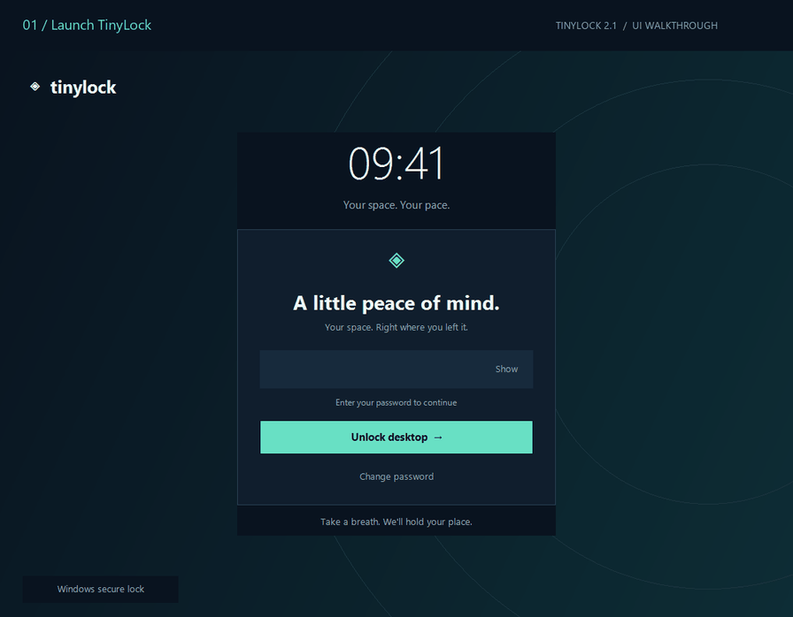

<div align="center">

# TinyLock

### A calmer space for your desktop.

A lightweight, full-screen Windows privacy screen with a refined interface, a live clock, and password-protected dismissal. Built with native C# and Windows Forms.

**Windows 10 / 11 · .NET Framework 4.8 · Version 2.1.0**

[Download lock.exe](https://github.com/ihamxaafzal/TinyLock/raw/refs/heads/main/lock.exe) · [Getting started](#getting-started) · [Build from source](#build-from-source)



*Animated walkthrough rendered from the application UI. The final confirmation is an explanatory slide; a successful unlock closes TinyLock.*

</div>

## Overview

TinyLock provides a simple privacy screen for short breaks and casual home use. Launch the app to cover your desktop, then enter your TinyLock password to return to your work. Its navy and teal interface keeps the experience focused and unobtrusive.

TinyLock is a desktop utility, **not a replacement for the Windows system lock**. Use the built-in **Windows secure lock** button or **Win+L** when Windows account protection is required.

## Features

- **Full-screen by default:** borderless, topmost coverage across the virtual desktop, with no interactive windowed preview mode.
- **Password-protected dismissal:** ordinary Close and Alt+F4 requests are cancelled until the correct password is entered.
- **Clear feedback:** masked password entry, Show/Hide, Enter to unlock, and inline errors.
- **Thoughtful interface:** ambient gradient, live time and date, and a compact layout for smaller displays.
- **Password management:** current-password verification, confirmation, and a minimum of four characters for new passwords.
- **Retry pause:** a 15-second cooldown after every five incorrect unlock attempts.
- **Native Windows build:** no Python runtime, external background image, administrator elevation, or global keyboard hooks required.
- **Windows integration:** a dedicated button invokes the Windows secure lock.

## Getting started

1. Download [lock.exe](https://github.com/ihamxaafzal/TinyLock/raw/refs/heads/main/lock.exe) and place it in a folder your Windows account can write to.
2. Run `lock.exe`. TinyLock opens full-screen immediately.
3. Enter the initial password **`1122`**, then select **Unlock desktop** or press **Enter**.
4. Use **Change password** to replace the publicly documented default before relying on the app for casual privacy.

No installation or administrator privileges are required. Windows 10 or 11 with **.NET Framework 4.8 or later** is required. A Windows system lock uses your Windows account password, PIN, or Windows Hello—not your TinyLock password.

### Change your password

Select **Change password**, enter your current password, then enter and confirm a new password containing at least four characters. Select **Save password**. The new password is saved for future launches.

### Password storage

TinyLock creates `tinylock.credentials` beside the executable. It stores a salted PBKDF2-SHA256 password hash with **210,000 iterations**, protected using Windows DPAPI for the current Windows account. Keep this file beside the executable and do not commit it to version control.

This version does not import credentials from the legacy Python build. Its initial native-build password is `1122`. The earlier `password.enc` and `secret.key` files are not used.

## Security and antivirus

TinyLock runs as a normal desktop application. Windows security shortcuts, Task Manager, administrator tools, and operating-system controls remain available. It cannot guarantee that a determined user will be unable to bypass it. Deleting its local credential file also resets first-run credentials. Use the Windows system lock to protect access to your Windows session.

The executable is **unsigned**. This version removes the bundled Python executable and global keyboard hooks, but antivirus acceptance is not guaranteed and no antivirus certification is claimed. If a security product flags the file, leave it blocked and submit it to that vendor for analysis. Do not disable antivirus protection or add exclusions to run it.

The included [SHA256SUMS.txt](SHA256SUMS.txt) identifies the binary in this repository; a checksum is an integrity check, not a safety certification.

## Build from source

The application uses the .NET Framework compiler and Windows libraries. No NuGet dependencies are required.

```powershell
git clone https://github.com/ihamxaafzal/TinyLock.git
cd TinyLock
& .\build.ps1
```

The build writes `lock.exe` to the repository root. To run the included checks without opening a lock screen:

```powershell
& .\test.ps1
```

The checks cover the default password, rejection of incorrect passwords, Unicode passwords, persisted credentials, full-screen bounds, topmost and borderless settings, and successful unlock. Tests use temporary credentials and leave your app password unchanged.

## Project layout

| Path | Purpose |
| --- | --- |
| `lock.exe` | Native Windows application |
| `Script/TinyLock.cs` | Application source and internal self-tests |
| `Script/icon123.ico` | Application icon |
| `Script/lock.py` | Optional compatibility launcher for the native executable |
| `build.ps1` | Windows build command |
| `test.ps1` | Noninteractive validation |
| `tinylock-demo.gif` | Animated UI walkthrough |
| `SHA256SUMS.txt` | Published executable checksum |

## What's new in 2.1

The original Python/Tkinter application has been replaced with a native C#/WinForms implementation. This update introduces a redesigned interface, full-screen-only interactive launches, hashed credentials protected with DPAPI, password confirmation, inline feedback, retry cooldowns, and Windows secure-lock integration. The legacy background asset is retained for compatibility but is not required by the native application. Previous versions remain in Git history.

Created by [MHamxa](https://github.com/ihamxaafzal).


